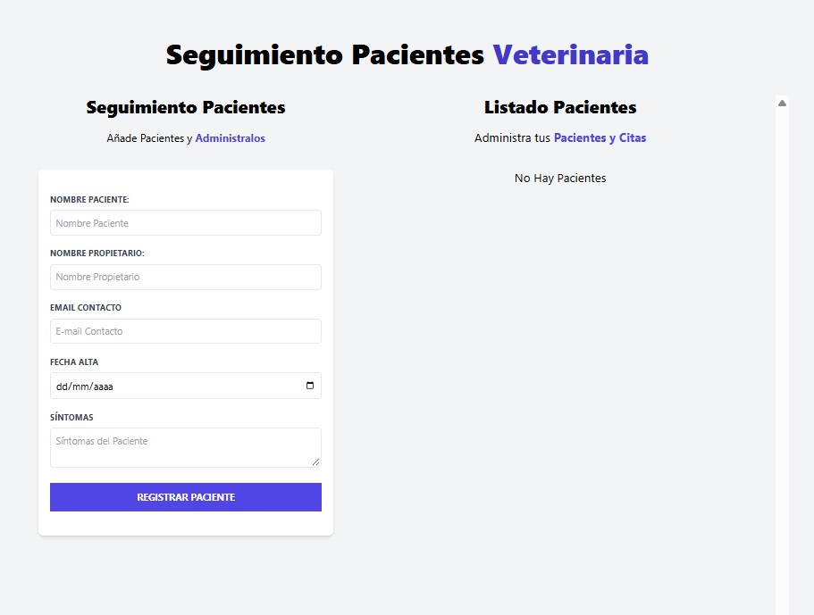
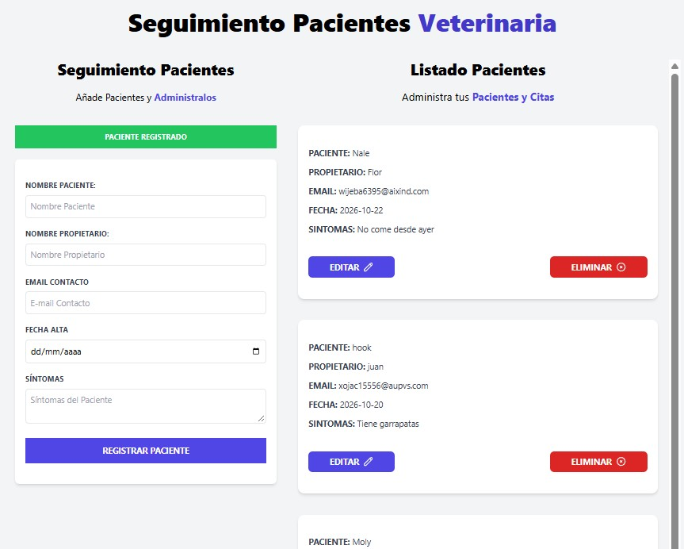
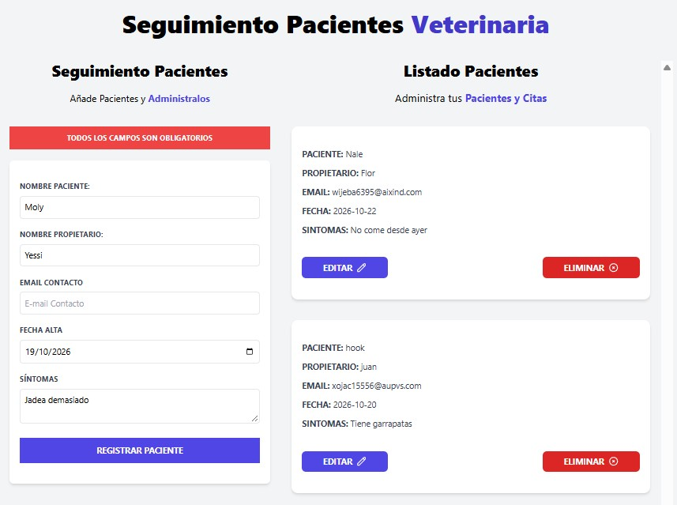

# appointment Management

An veterinary medical appointment management application built with JavaScript that allows users to register, edit, delete, and store information about patients and their owners in real time with data persistence.
## Live Demo

[View the project](https://absantamariav.github.io/administrador-citas/)

## Features

* Full CRUD Management: Allows you to create, read, update, and delete patient appointments.
* Data Persistence: Uses localStorage to preserve the list of appointments even after reloading or closing the page.
* Real-Time Validation: Checks for required fields in the form with custom dynamic alerts.
* Interactive Interface: Modern, stylized UI built with Tailwind CSS and real-time DOM updates.
* Modular Architecture: Object-Oriented Programming (OOP) implementation using classes to handle notification logic and appointment management.

## Technologies

* HTML5
* CSS3
* JavaScript (ES6+)
* Tailwind CSS.

## 📸 Screenshots

### Main Interface


### Register Pacient


### Alert Error


## Run Locally

Clone the repository:

```bash
git clone https://github.com/absantamariav/administrador-citas.git
```

Open the project folder and run `index.html` using a local development server such as **Live Server** in Visual Studio Code.

## Author

**Anderson Santamaria**

* GitHub: [@absantamariav](https://github.com/absantamariav)
